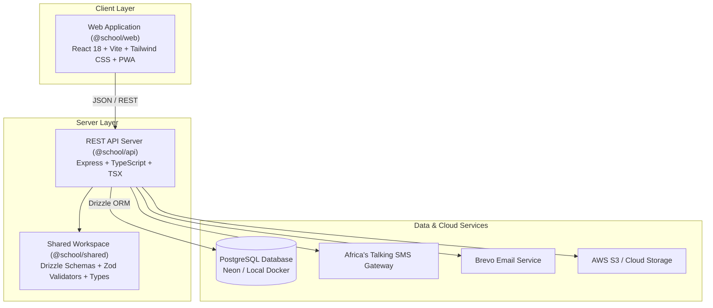

<div align="center">

# School Management System (SMS)

**A modern, multi-role, open-source school management platform built for modern educational workflows and the Kenyan Competency-Based Curriculum (CBC).**

[](LICENSE)
[](CONTRIBUTING.md)
[](https://www.typescriptlang.org/)
[](https://react.dev/)
[](https://nodejs.org/)
[](https://tailwindcss.com/)
[](https://orm.drizzle.team/)
[](https://www.postgresql.org/)

[Features](#-key-features--role-architecture) • [Quick Start](#-quick-start) • [Tech Stack](#-tech-stack) • [Roadmap](#-roadmap) • [Contributing](#-how-to-contribute) • [Contact](#-maintainer--community)

</div>

---

## Why This Project?

Schools in emerging markets and East Africa face administrative overload, paper-heavy record keeping, and expensive proprietary ERP software that doesn't fit local curricula. 

This project is an **open-source, production-ready, full-stack School Management System** designed with:
- **Native CBC Support**: Pre-Primary (Playgroup, PP1, PP2), Lower Primary (Grades 1–3), Upper Primary (Grades 4–6), and Junior Secondary (Grades 7–9), KNEC assessment numbers, term-based academic workflows, and KES fee structures.
- **Role-Based Architecture**: Clear boundaries and purpose-built dashboards for **Head Teachers, Deputy Heads, Directors of Studies, Bursars, Secretaries, and Teachers**.
- **Real-World Integrations**: Africa's Talking SMS for instant parent absence alerts, Brevo for transactional email & 2FA, and Neon PostgreSQL for serverless database scaling.
- **Offline-Ready Progressive Web App (PWA)**: Built for varying network connectivity in school offices and classrooms.

### We Are Looking For Volunteering Contributors!
Whether you are an aspiring full-stack engineer, a frontend dev, a seasoned developer wanting to give back to education, or an open-source enthusiast, this project provides a well-organized monorepo, clear tasks, responsive maintainers, and real social impact. Check out our [Contributing Guide](CONTRIBUTING.md) and [Roadmap](ROADMAP.md) to pick your first task!

---

## System Architecture



---

## Key Features & Role Architecture

The platform models the operations of a modern educational institution through 6 specialized roles:

| Role | Key Capabilities |
|------|------------------|
| **Head Teacher** | High-level school oversight, staff invitations & directory, printable employment contracts, school fees approval, academic term management, student transfer approvals, official document generator. |
| **Deputy Head Teacher** | Teacher-class and subject allocations, teacher leave-out management & slips, inventory/asset tracking, school-wide attendance oversight, instant parent absentee SMS alerts. |
| **Director of Studies (DoS)** | Timetable generation wizard, exam & CAT assessment coordination, invigilation and marking allocation, score audits, report card generation & locking. |
| **Bursar / Finance** | Term billing & student fee ledgers, payment recording (M-Pesa / Bank / Cash), receipt generation, expense tracking & categorization, financial reporting. |
| **Secretary** | Student admissions & guardian directory, multi-sibling linking, visitor logs, school calendar & events, meeting minutes archive. |
| **Teachers (Class & Subject)** | Daily attendance register, subject-specific CAT and exam score entry, automated student performance grading, timetable view. |

---

## Tech Stack

### Monorepo Structure
- **npm Workspaces**: Clean separation of frontend, backend, and shared packages.
- **TypeScript**: End-to-end type safety from database schemas to UI components.

### Frontend (`apps/web`)
- **React 18** + **Vite 5**
- **Tailwind CSS** + **Lucide React** icons
- **TanStack Query (React Query) v5** for optimistic caching & server synchronization
- **React Router v6**
- **Framer Motion** for micro-interactions
- **Vite PWA Plugin** for offline caching and desktop/mobile installability

### Backend (`apps/api`)
- **Node.js 20+** with **Express**
- **Drizzle ORM** + **PostgreSQL** (`postgres.js` driver)
- **Zod** schema validation for all endpoints
- **Argon2** password hashing & **JWT** token rotation
- **Pino** structured logging & **Helmet** security headers
- **Africa's Talking SDK** (SMS notifications) & **Brevo** (Transactional Email)

### Shared Package (`packages/shared`)
- Database tables and relations definition (Drizzle)
- Shared Zod validation schemas
- Domain types, enums, and data models

---

## Quick Start

### Prerequisites
- **Node.js**: v20.x or higher
- **npm**: v10.x or higher
- **Docker & Docker Compose** (for local PostgreSQL, or an existing [Neon](https://neon.tech) / PostgreSQL instance)

### 1. Clone the Repository
```bash
git clone https://github.com/Moha-abshir/School-Management-System.git
cd School-Management-System
```

### 2. Install Dependencies
```bash
npm install
```

### 3. Configure Environment Variables

Copy the provided `.env.example` templates for both the backend and frontend:

```bash
# Backend Environment
cp apps/api/.env.example apps/api/.env

# Frontend Environment
cp apps/web/.env.example apps/web/.env
```

> **Note**: For local development, the default values in `.env.example` are already pre-configured to work with the included Docker PostgreSQL container.

### 4. Start Local Database

You can start a local PostgreSQL 16 container with a single command:

```bash
docker compose up -d
```

*(Alternatively, paste your cloud [Neon](https://neon.tech) connection string into `apps/api/.env`).*

### 5. Push Database Schemas & Seed Data

Run the Drizzle schema push and database seed script to populate test roles, permissions, and sample users:

```bash
# Push schema tables to the database
npm run db:push

# Seed default roles, permissions, and admin accounts
npm --workspace=@school/api run db:seed
```

### 6. Start the Development Servers

Run both the frontend and backend simultaneously:

```bash
npm run dev
```

- **Frontend Application**: [http://localhost:5173](http://localhost:5173)
- **Backend API**: [http://localhost:5000](http://localhost:5000)

### Pre-Seeded Test Credentials
When you run the seed script, the following accounts are initialized for testing:
- **Head Teacher (Admin)**: `moabshir06@gmail.com` / `Password123!`
- **Teacher**: `teacher@school.test` / `Password123!`
- **Bursar**: `bursar@school.test` / `Password123!`
- **Deputy Head**: `deputy@school.test` / `Password123!`

---

## Repository Structure

```
School-Management-System/
├── apps/
│   ├── api/                    # Express REST API Backend
│   │   ├── src/
│   │   │   ├── config/         # Database, logger & server config
│   │   │   ├── middleware/     # Auth, session, rate-limit, permissions
│   │   │   ├── modules/        # Domain modules (auth, staff, subjects, timetable...)
│   │   │   ├── scripts/        # Database seed scripts
│   │   │   └── services/       # Email (Brevo), SMS (Africa's Talking), Audit
│   │   └── package.json
│   └── web/                    # React 18 + Vite Frontend (PWA)
│       ├── src/
│       │   ├── components/     # Reusable UI components & modals
│       │   ├── context/        # Auth & UI global contexts
│       │   ├── modules/        # Feature views (dashboard, staff, allocations, timetable...)
│       │   └── lib/            # Axios API client, query client, utilities
│       └── package.json
├── packages/
│   └── shared/                 # Shared TypeScript models & Drizzle schemas
│       ├── src/
│       │   ├── db/schema/      # Drizzle tables (admissions, academics, finance...)
│       │   ├── types/          # Shared domain interfaces & types
│       │   └── validators/     # Zod validation schemas
│       └── package.json
├── .github/                    # Issue & PR templates, GitHub configuration
├── docker-compose.yml          # Local PostgreSQL container definition
├── SMS_implementation_plan.md  # Detailed master technical roadmap
├── ROADMAP.md                  # Public contributor task board & milestones
├── CONTRIBUTING.md             # Contribution guidelines & workflow
├── CODE_OF_CONDUCT.md          # Community Code of Conduct
├── SECURITY.md                 # Vulnerability disclosure policy
└── LICENSE                     # MIT License
```

---

## Available Scripts

Run these scripts from the repository root:

| Command | Action |
|---------|--------|
| `npm run dev` | Starts all workspaces in parallel development mode |
| `npm run build` | Builds all packages and applications for production |
| `npm run db:push` | Pushes Drizzle schema changes directly to the PostgreSQL database |
| `npm run db:generate` | Generates Drizzle migration SQL files |
| `npm --workspace=@school/api run db:seed` | Populates database with initial roles, permissions, and test accounts |
| `npm --workspace=@school/web run preview` | Previews the production frontend build locally |

---

## Roadmap & Current Status

We are actively executing the phased roadmap outlined in [ROADMAP.md](ROADMAP.md) and [SMS_implementation_plan.md](SMS_implementation_plan.md):

- [x] **Core Authentication & 2FA** (JWT, OTP, session management)
- [x] **Staff Management** (Invitations, onboarding, directory, employment contracts)
- [x] **Subject & Teacher Allocation** (CBC subject codes, qualification mapping, interactive wizard)
- [x] **Timetable Engine Core** (Constraint validation, period grids, clash detection)
- [ ] **Phase 1: Head Teacher Module** (Fee structures, academic terms, official letter generator)
- [ ] **Phase 2: Deputy Head Teacher Module** (Leave-out management, inventory, parent absentee SMS)
- [ ] **Phase 3: Director of Studies (DoS)** (Exam score entry & verification, report card lock workflow)
- [ ] **Phase 4: Bursar Module** (Fee invoicing, payment tracking, M-Pesa receipts, expense ledger)
- [ ] **Phase 5: Secretary Module** (Student admissions, guardian sibling linking, visitor records)
- [ ] **Phase 6: Teachers & Class Management** (Daily registers, CAT mark entry, report remarks)

See [ROADMAP.md](ROADMAP.md) for detailed task breakdowns and available issues.

---

## How to Contribute

We welcome and appreciate all contributions: code, bug fixes, UI/UX polish, documentation improvements, and feature testing!

1. **Find an Issue**: Browse open [GitHub Issues](https://github.com/Moha-abshir/School-Management-System/issues) or check [ROADMAP.md](ROADMAP.md). Look for the `good first issue` and `help wanted` tags.
2. **Claim the Task**: Comment on the issue asking to be assigned before starting work.
3. **Follow the Guidelines**: Read our complete [CONTRIBUTING.md](CONTRIBUTING.md) guide for details on branch naming, Conventional Commits, and pull request reviews.
4. **Submit a Pull Request**: Push your branch and open a PR with the provided PR template.

---

## Security

If you discover a security vulnerability within this project, please consult our [Security Policy](SECURITY.md) for instructions on confidential disclosure. Please do not report security vulnerabilities via public GitHub issues.

---

## License

This project is open-source software licensed under the **[MIT License](LICENSE)**.

---

## Maintainer & Community

- **Project Lead**: Mohamed Abshir
- **Email**: [moabshir06@gmail.com](mailto:moabshir06@gmail.com)
- **Phone / WhatsApp**: `+254 714 731 331`
- **GitHub**: [@Moha-abshir](https://github.com/Moha-abshir)
- **Discussions & Questions**: Feel free to open a thread on [GitHub Discussions](https://github.com/Moha-abshir/School-Management-System/discussions) or reach out directly!
